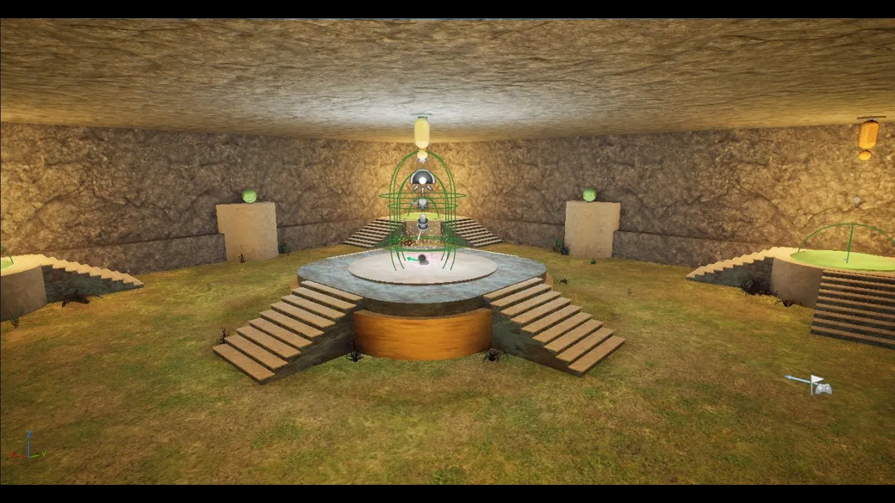

<div align="center">

# Dana Gómez Casañ

---

### Programmer, Designer

[](https://leinadvsw.wixsite.com/)
[](mailto:danheisei4@gmail.com)
[](https://www.linkedin.com/in/dana-gomez-casan/)
(header art by Michael Whelan)
</div>

---

## About Me

*Lady Dana of Gómez and Casañ, Mistress of Code and Squire of Design in the Ludic Arts. First of her/their name.*

Hello, I am Dana, a software engineer with more than 6 years of experience in the games industry, and another few years of software development in additional fields. In my time in games I have worked on a wide variety of disciplines: including Tools, AI, Gameplay, UI, and even Tech Design for a particular project, doing mostly Quest and World Design. However, my two areas of focus have so far been GUI development, which I always gravitate toward; and AI for games and procedural generation, topics I have loved ever since I tried mashing them together for my Master's thesis.

In my spare time, I play games in any format, and my personal projects range from video games and tools for RPGs, to creative writing and map drawing.

## Highlights

```
🎓 MSc in Computer Games Technology
🎮 Worked on Vampire: The Masquerade - Bloodhunt, Hogwarts Legacy, Exoborne, in addition to several other undisclosable projects (I am credited as Daniel Gómez-Casañ in them)
⚔️ Personal projects including game jams, prototyping, GUI development, and creative writing
🧪 Additional professional experience in research centres and a start-up
```

<div align="center">


</div>

As for my personal projects, I participated in the GGJ2026 in a team of five, and also in a solo-jam of four days to prototype a game in unreal engine 5
<div align="center">


</div>


---

## Tech Skills

| Programming Languages | Game Development | Disciplines          | Tools and Frameworks | Other Technical Skills  |
| --------------------- | ---------------- | -------------------- | -------------------- | ----------------------- |
| C++                   | Unreal Engine    | AI for Games         | imgui                | Computer Vision         |
| C#                    | Unity            | Tools Programming    | Qt                   | Test Driven Development |
| Python                | Godot            | Gameplay Programming | Git                  | ECS                     |
| HLSL                  | DirectX          | User Interface       | Perforce             | Data processing         |
| GLSL                  | OpenGL           | Engine Programming   | UGS                  | Debugging               |
| R                     | SFML             | Optimisation         |                      | Physics                 |
|                       |                  | Prototyping          |                      |                         |


---

## GitHub Stats

<div align="center">


</div>

---

<div align="center">

### *onward and upward*

</div>
